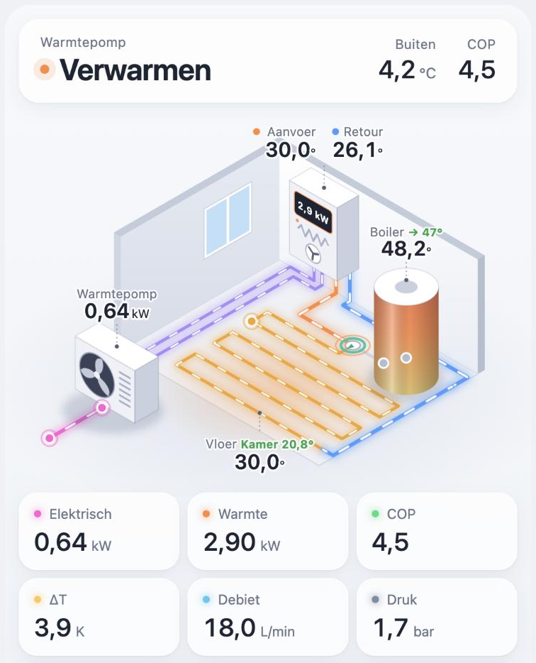

# Heatpump Card

[](https://hacs.xyz/docs/faq/custom_repositories)
[](https://github.com/michielvgrootel/hass-heatpump/actions/workflows/validate.yml)



A custom Home Assistant Lovelace card that shows an air-to-water heat pump as an animated isometric scene:

- **Header panel**: the current mode in large type, with the outside temperature and COP.
- **Scene**: a cut-away room on a light background with the outdoor unit, indoor unit, DHW tank and floor heating loop. Floating labels with dotted leaders show electrical power, supply, return, tank and floor temperatures.
- **Glowing flow lines**: electricity in (pink), the link between outdoor and indoor unit (violet), supply water from the indoor unit to the tank or floor (orange, rose when heating the tank) and return water back to the indoor unit (blue). The dashes move faster at a higher flow rate, and only the circuit the 3-way valve has chosen lights up. No two pipes cross. In cooling the supply turns ice-blue and the return amber.
- **Outdoor unit**: the fan spins faster as the electrical power goes up. During defrost it shows a frost overlay and turns slowly backwards.
- **Indoor unit**: a small display with the heat output, a booster coil that glows when the booster is on, and a circulation pump.
- **Tank**: its colour follows the tank temperature, and it glows while it is being heated.
- **Tiles**: electrical power, heat output, COP, ΔT, flow rate and pressure. Pressure below 1 bar or above 2.8 bar is shown in red.
- **24 h history chart**: supply, return, tank and outside temperatures, with power use as a background area.
- Tap any part of the card to open that entity's more-info dialog. Labels are Dutch or English (based on your HA language). The card always uses its own light style, whatever your theme.

## Install

### Via HACS (recommended)

[](https://my.home-assistant.io/redirect/hacs_repository/?owner=michielvgrootel&repository=hass-heatpump&category=plugin)

Or add it by hand:

1. In Home Assistant open **HACS**, then **⋮ → Custom repositories**.
2. Repository: `https://github.com/michielvgrootel/hass-heatpump`, type: **Dashboard**. Click **Add**.
3. Search for **Heatpump Card**, open it and click **Download**.
4. Hard-refresh the browser (Cmd+Shift+R). HACS registers the dashboard resource for you.

Updates show up in HACS whenever a new release is published.

### Manual

1. Copy `heatpump-card.js` to `/config/www/heatpump-card.js`.
2. In HA go to **Settings → Dashboards → ⋮ → Resources → Add resource**:
   - URL: `/local/heatpump-card.js`
   - Type: **JavaScript module**
3. Hard-refresh the browser (Cmd+Shift+R).

## Configure

**Visual editor:** add a card, search for **Heatpump Card** and fill in the entity fields. They're grouped as Status & outside, Water, Power & COP, Floor & room and Extra signals. Every field is optional:

- **COP:** pick your own COP sensor (for example a daily COP). Leave it empty and the card calculates COP from heat ÷ electrical, shown only while the compressor runs.
- **Vloertemperatuur:** the floor label shows this sensor. Leave it empty and the label shows the room temperature as "Kamer", or is hidden if that's empty too.
- **Warmte-/koelvermogen:** leave it empty and it's calculated from flow × ΔT.

**YAML:** add a **Manual** card and paste the config below. Replace the entity IDs with your own (go to Developer tools → States and search for `bridge0`).

```yaml
type: custom:heatpump-card
title: Warmtepomp
entities:
  status: sensor.bridge0_status                 # text state: Warmwater / Verwarmen / Uit / Defrost …
  outside_temp: sensor.bridge0_sensors_temperature_outside
  flow_temp: sensor.bridge0_outlet_temperature  # supply / outlet (25,4)
  return_temp: sensor.bridge0_inlet_temperature # return / inlet  (20,6)
  dhw_temp: sensor.bridge0_dhw_temperature      # tank temp (37,1)
  dhw_target: water_heater.bridge0_dhw          # water_heater/climate (uses its target) or a sensor
  flow_rate: sensor.bridge0_pump_flow           # L/min
  pressure: sensor.bridge0_water_pressure       # bar
  power_in: sensor.bridge0_power_total          # W or kW (auto-converted)
  power_out: sensor.bridge0_heat_power          # optional; otherwise calculated from flow × ΔT
  dhw_demand: binary_sensor.bridge0_dhw_demand  # optional
  defrost: binary_sensor.bridge0_defrost        # optional
  booster: sensor.warmtepomp_booster_huidig_gebruik  # optional, W
  floor_temp: sensor.floor_temperature          # optional; floor label (hidden when empty)
  room_temp: sensor.living_room_temperature     # optional
  cop: sensor.heatpump_cop                      # optional; otherwise power_out / power_in
```

### Options

| option | default | what it does |
|---|---|---|
| `title` | `Warmtepomp` | card title |
| `show_history` | `true` | show the history chart |
| `hours` | `24` | how many hours the chart covers |
| `history_entities` | `[flow_temp, return_temp, dhw_temp, outside_temp]` | entity keys from `entities` or full entity IDs |
| `min_power` | `50` | watts above which the compressor counts as running |
| `language` | HA language | `nl` or `en` |
| `status_map` | built-in | map your own status texts to `dhw`, `heating`, `cooling`, `defrost`, `idle` or `off` |

If your status sensor uses other words, map them like this:

```yaml
status_map:
  "tapwater bereiden": dhw
  "cv bedrijf": heating
```

If no `status` entity is set, the mode comes from `defrost`, `dhw_demand` and `power_in`.

## Preview without HA

Run `python3 -m http.server 8765` in this folder and open <http://localhost:8765/preview.html>. The preview uses mock data and has buttons to switch between the Warmwater, Verwarmen, Koelen, Ontdooien, Booster and Uit scenarios. Below the card is a test version of the visual editor that shows the resulting config.

## License

MIT
